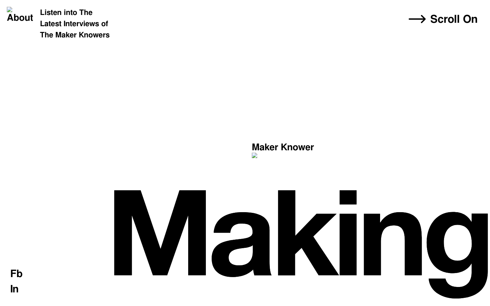
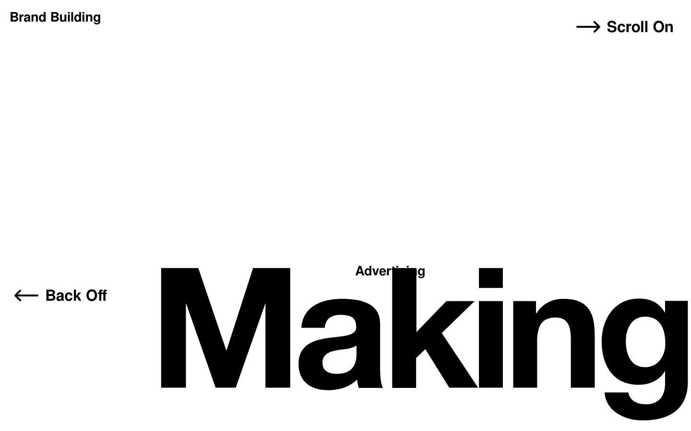
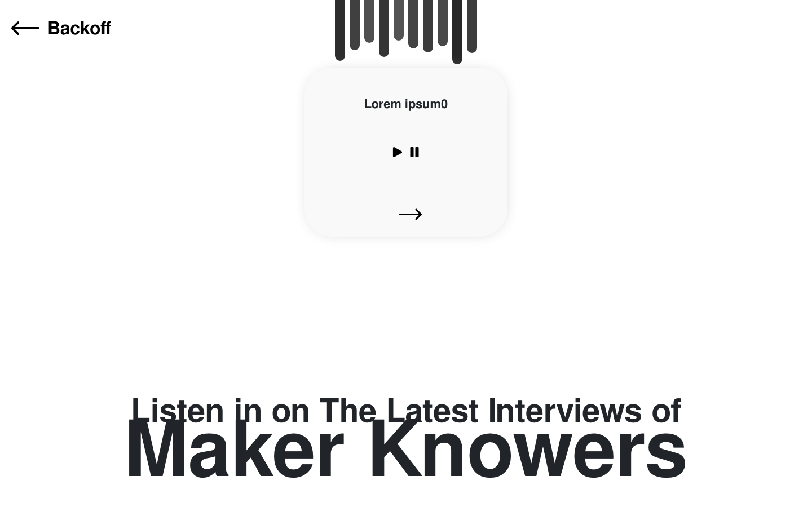
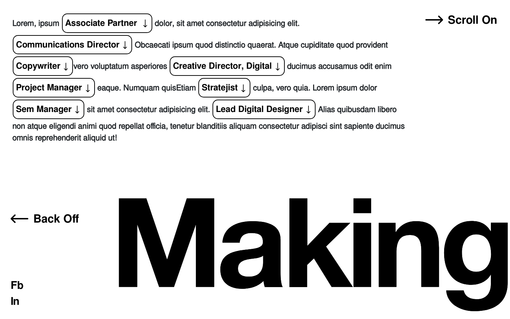
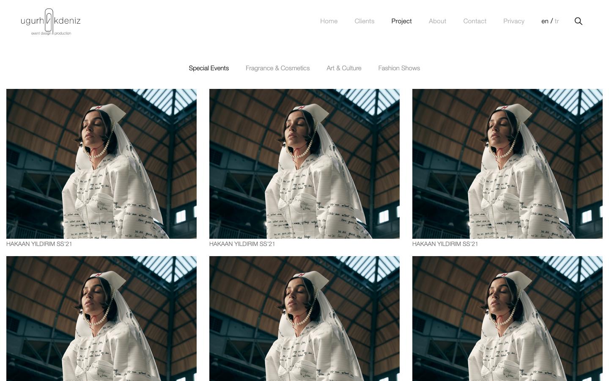
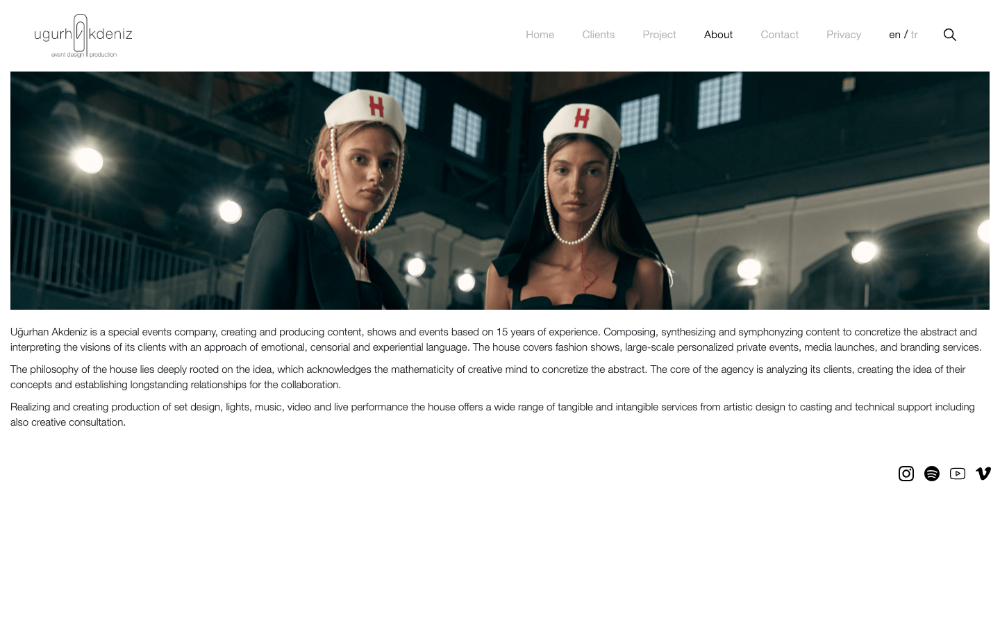
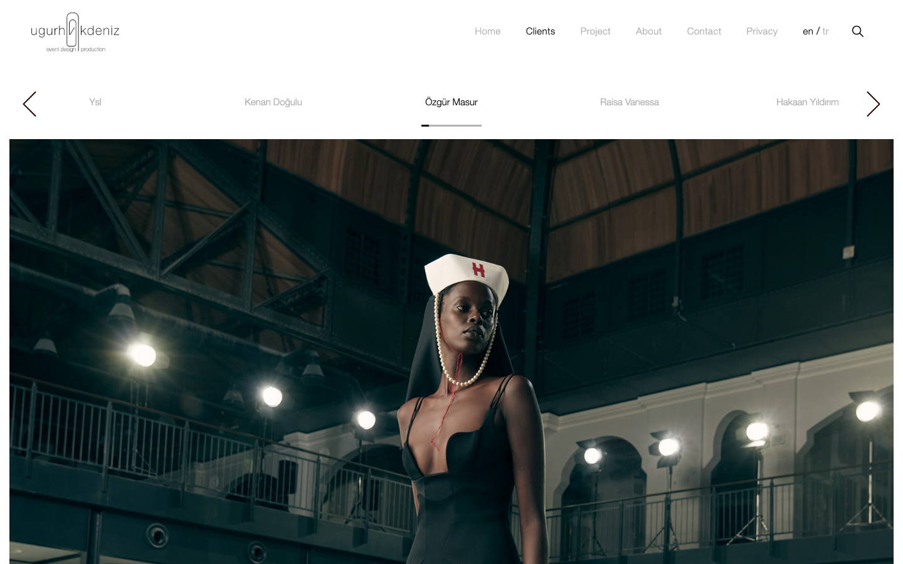

# MakingKnowing — Studio & Client Sites

**Front-end and CMS work from my time as lead web developer at MakingKnowing, a creative agency for fashion, luxury and culture brands**: the agency's own editorial site with its podcast and CMS, a designer e-commerce store, and a portfolio site for a special-events company.




| | |
|---|---|
| **Role** | Lead web developer: design implementation, front end and CMS |
| **Period** | 2019 |
| **Projects** | MakingKnowing (agency site + CMS) · Özgür Masur (designer e-commerce) · Uğurhan Akdeniz (events portfolio) |
| **Stack** | PHP · CodeIgniter 3 · MySQL · Bootstrap 5 · jQuery · Owl Carousel · Plyr · iyzico |

## Projects

### 1. MakingKnowing — agency site and CMS · [`makingknowing-site/`](makingknowing-site)

An editorial, type-led site: oversized wordmark, horizontal "scroll on" navigation, and sections for work, achievements, careers and the **Maker Knowers** podcast with an inline audio player.

- `templates/`: the static front end, page by page.
- `app/`: the same pages on CodeIgniter with a CMS: works, achievements, podcast episodes, channel, blog, careers and job applications, campaigns, menus, sliders, translations and SEO meta (32 admin modules, 43 controllers, 49 models).

| | | |
|---|---|---|
|  |  |  |
| **What we do** | **Maker Knowers podcast** | **Careers:** role chips |

### 2. Özgür Masur — designer e-commerce · [`ozgurmasur/`](ozgurmasur)

Storefront and admin views for a fashion designer's online store, in English and Turkish: collections, product pages, bag and checkout with iyzico, stockists and contact, plus the store's admin panel (products, orders, content).

### 3. Uğurhan Akdeniz — special-events portfolio · [`ugurhanakdeniz/`](ugurhanakdeniz)

Portfolio for a special-events and fashion-show production company: full-screen video hero, project gallery filtered by discipline (special events, fragrance & cosmetics, art & culture, fashion shows), client carousel and about page.

| | | |
|---|---|---|
|  |  |  |
| **Projects** by discipline | **About** | **Clients** |

## Running the templates

```bash
php -d short_open_tag=On -S localhost:8093 -t makingknowing-site/templates
php -d short_open_tag=On -S localhost:8094 -t ugurhanakdeniz
```

The CodeIgniter applications are archived without configuration and the framework `system/` folder, so they are shown as source.

## What I would do differently today

- Build the type-led layouts as **responsive components** with fluid type scales instead of fixed breakpoints, so the oversized wordmark degrades gracefully on phones.
- Store **hashed passwords** for admin users and move login checks into a dedicated auth library.
- Serve the photography and video through an **image/video pipeline** (responsive sizes, modern formats, lazy loading).

---

<sub>Built at MakingKnowing for the agency and its clients. Credentials and personal contact details have been removed, and large video files are not included. Shared for portfolio purposes; no license is granted for reuse.</sub>
